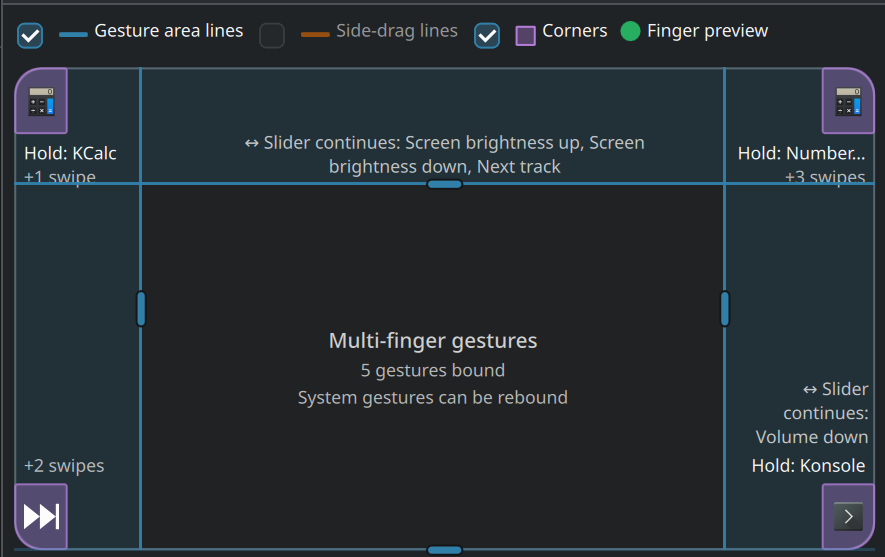

# KAGeT – KDE Advanced Gesture Touchpad

  

Configurable touchpad gestures for KDE Plasma (Wayland) on any multitouch touchpad: corner holds and swipes,
sliders (volume, brightness, keyboard backlight) with a continuation window, 3+ finger swipes, pinches,
taps, double taps and side drags, plus optional ASUS NumberPad support.

| Component | Path | Language |
|---|---|---|
| `kagetd` – daemon | `kagetd/` | Rust |
| `kaget` – settings app with touchpad visualizer | `ui/` | C++ / Qt 6 / QML / Kirigami |
| `kaget-panel` – touchpad control panel (brightness, volume, keyboard backlight, action buttons) | `ui/panel/` | C++ / Qt 6 / QML |

The app talks to the daemon only over D-Bus (`io.github.kaget`, `/io/github/kaget/Daemon`,
`io.github.kaget.Daemon1`).

## Touchpad map

The settings app draws the touchpad to scale: drag the lines to resize the gesture areas, see what each corner
and slider band is bound to, and watch your fingers live while you test.

  

## Modes

- **Passive** (default): reads the touchpad alongside KDE. KDE keeps its own gestures.
- **Filter** (`general.mode = "filter"`): grabs the touchpad and re-emits it through a uinput clone, withholding
  touches that become KAGeT gestures. Needed to override KDE's 3/4-finger gestures; the pointer does not move
  during corner gestures and NumberPad keys do not click.

## Build

    cargo build --release                       # target/release/kagetd
    cargo test
    cmake -S ui -B ui/build -G Ninja && cmake --build ui/build   # ui/build/bin/kaget
    ui/build/bin/kaget --demo                   # UI with bundled sample data, no daemon needed

Arch Linux package: `makepkg -p packaging/PKGBUILD` (installs the daemon, a systemd user unit and udev rules).

## Run

    systemctl --user enable --now kagetd
    kagetd --probe          # touches in mm with the zone under them
    kagetd --record f.jsonl / --replay f.jsonl

Needs write access to `/dev/uinput` (key actions, NumberPad, filter mode) – see `packaging/70-kaget.rules`.

## License

GPL-3.0-or-later (the UI sources are GPL-2.0-or-later). See [`LICENSE`](LICENSE).
